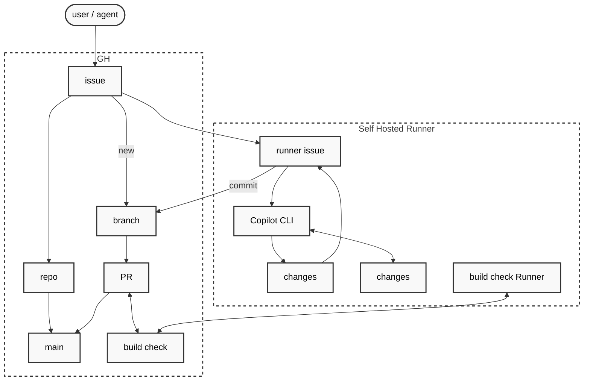

# 14 - Issue-triggered agent workflow

An issue opened on the version control host is treated as a prompt. A self-hosted runner reads it, gates it, hands
the repository's working copy to an AI engine, validates what the engine produced, and returns the result to the host
as a branch, a pull request, a comment and a closed issue.

This document states the behaviour, the refusal conditions and the acceptance criteria. It names no file, folder,
class or path, because the contract is about the sequence and the trust boundaries rather than about a layout. It
consumes the gate of [12-pipeline](12-pipeline.md) as its validation step and shares nothing with the surface of
[10-surface](10-surface.md).

Related: [13-agent](13-agent.md), [09-gate](09-gate.md), [12-pipeline](12-pipeline.md)

## Scope

Coop adds one capability to a repository: an issue can be answered by an agent, and the answer arrives as a reviewable
change. This document specifies the sequence, the trust boundaries and the decisions a deployment must make, so that
the capability is one implementation serving many repositories rather than one repository's script copied around.

Coop contributes the orchestration, the trigger gate, the engine invocation contract, the validation call and the
completion rules. It contributes no merge automation, no issue tracker of its own, no conversation store and no
approval mechanism.

| In scope | Out of scope |
| --- | --- |
| Reading and gating a trigger | Deciding whether a change is desirable |
| Handing a working copy to an engine | The engine's own reasoning, tools or prompt strategy |
| Obtaining model credentials and withholding version control credentials | Issuing or rotating either credential |
| Deciding what the engine may touch | Deciding what a reviewer should approve |
| Taking a verdict from a gate | Being the gate; see [12-pipeline](12-pipeline.md) |
| Offering a validated change for merge | Merging it |

A deployment that has a runner and a gate already has everything this specification consumes. That is the intended
adoption path: the capability is a sequence over existing components, not a new service.

## The central rule

An issue body is untrusted text written by whoever opened the issue, and it becomes the prompt of an engine that can
execute commands. Every other rule in this document follows from that one.

| Consequence | Rule |
| --- | --- |
| The text is data, never instruction to the runner | The runner never evaluates, expands or interpolates anything from the issue into a command line, a script, or configuration. The issue text reaches the engine as one argument, quoted by the runner's own argument handling, and nowhere else. |
| The text can instruct the engine | The engine's tool grants are the runner's decision and are fixed before the text is read. A grant is never widened by anything the issue says. |
| The engine runs with the runner's authority | The engine's process environment carries no version control credential. See Git ownership. |
| The engine's output is untrusted too | What the engine writes is validated before it is offered for merge, and the paths it may not touch are checked explicitly. See Validation. |

## Actors

| Actor | Holds | Does |
| --- | --- | --- |
| Trigger | A human with write access, or an automation acting for one | Opens the issue that starts the run. |
| Version control host | The repository, its default branch, the issue tracker and pull requests | Delivers the event, receives the branch, the pull request, the comment and the close. |
| Orchestrator | Process authority on the runner, the version control credential, the model credential | Runs the sequence, owns every version control operation, holds the validation verdict. |
| AI engine | A working copy and a model credential, for the duration of one run | Mutates the working copy in place and emits an event stream. Holds no version control credential and performs no version control operation. |
| Validation environment | The ability to build and test a candidate change, and nothing else | Produces a verdict. Holds no credential that could alter the repository. |

The orchestrator and the validation environment are separate roles. Whether one machine fills both is a deployment
decision; whether one credential serves both is not, and the answer is no. See Validation.

## The shape of the flow

Read it as four boundaries rather than as the sequence:

| Boundary | What crosses it |
| --- | --- |
| Trigger to host | A person or an automation opens an issue. The host owns the issue, the repository and the default branch. |
| Host to orchestrator | The event delivers the issue's context inward. Nothing is returned on this edge; the answer comes back on the two below. |
| Orchestrator to host | Exactly one artefact crosses outward, and it is a commit on a new branch. The engine's changes never reach the host by any other route, which is the Git ownership rule drawn as an edge. |
| Host to validation | The pull request and its build check. The two nodes on either side are the same check seen from each side, which is why the edge is drawn both ways. |

Two things the diagram does not show, and a reader who takes it as the whole contract will build the wrong thing:

- **The gate.** The edge from the trigger to the orchestrator carries untrusted text, and something must refuse most of
  it. That refusal is the first thing the orchestrator does and has no node here. See The gate on who may trigger.
- **The credential asymmetry.** The engine node holds a model credential and no version control credential. The
  existing edges do not distinguish the two, so the diagram would permit an engine that pushes. See Git ownership.

The two `changes` nodes are the working copy seen twice: once as what the engine reads and writes, and once as the
mutated tree handed back to the orchestrator. They are one object in an implementation, and the diagram draws them
apart to make the handover explicit.

## The sequence

Nine steps. Each states its precondition and the refusal that stops it.

| # | Step | Precondition | Refusal |
| --- | --- | --- | --- |
| 1 | Event received | An issue event reached the orchestrator, with the payload available | 8 |
| 2 | Gate | The event is an issue, the acting author is on the permitted list, and the event does not originate from an automation | 8 |
| 3 | Context assembled | The issue number, title, body and source link read whole and unmodified | 8 |
| 4 | Working copy prepared | A clean checkout of the default branch's current remote head, at a revision the run records | 10 |
| 5 | Engine invoked | The credential was obtained and the executable resolved; the working copy is exclusively the engine's | 9 |
| 6 | Progress reported | The engine appends one line per completed step to the progress channel | none, a missing line is not a failure |
| 7 | Validation | The candidate change is built and tested by the gate | none, a failed gate is an outcome not a refusal |
| 8 | Offered for merge | The validated content is committed, pushed on a branch derived from the issue, and a pull request opened against the default branch | 11 |
| 9 | Reported and closed | The pull request link and the verdict are commented on the issue; the issue is closed only when the gate passed | 11 |

Steps 7 and 8 are ordered deliberately: validation precedes the push, so whether a failing change is pushed at all is a
decision the deployment makes rather than something that happens to it. Both answers are defensible and they differ in
what a reviewer sees:

| Choice | Consequence |
| --- | --- |
| Push only on a pass | A failing change never becomes a pull request; the failure exists only as a run and a comment, and the work is lost with the working copy unless the run preserves it |
| Push regardless, and report the verdict | The work survives and a human can finish it, at the cost of a red pull request that looks like an offer to merge |

A deployment states which it does. The completion table below assumes the second, because losing work on a transient
failure is the worse of the two, and because a red verdict attached to a visible change is more honest than a change
that never appeared.

## The gate on who may trigger

| Rule | Statement |
| --- | --- |
| Association list | A permitted acting author is one whose association with the repository is owner, member or collaborator. The list is configuration and is read per run. |
| Not an issue | An event whose subject is a pull request is refused even when the field that carries an issue is present, because the host delivers pull request activity through the same payload shape. |
| Automation origin | An event authored by an automation is refused by default. An engine that opens an issue which triggers an engine is unbounded work, and the loop is broken at the gate rather than by a timeout. |
| Refusal is silent to the host | A refused trigger produces no comment, no branch and no pull request. A refusal that comments on the issue tells the author which strings are permitted, which is the one thing a probe wants. It is recorded in the run log and in the run's own status only. |
| Absent association | A payload without an association field is refused, never permitted. The default is deny. |

## The engine invocation contract

### The working copy

The engine receives a working directory and mutates it in place. It does not return a change set, a patch, or a list
of edits; the mutated tree is the output. This is the whole reason the runner must hand over an exclusive copy: two
engines in one tree interleave writes and neither result is attributable.

| Rule | Statement |
| --- | --- |
| Exclusive | One engine per working copy at a time. Concurrent runs use separate copies or are serialised. |
| Clean before handover | The copy has no uncommitted change and no untracked file the run did not create, so that recording the outcome cannot sweep an unrelated edit into the change. |
| Recorded base | The revision the copy was taken from is recorded with the run, so the change can be re-derived and the branch can be re-created. |
| Disposable | After the run the copy is expendable. Nothing the engine wrote is reused as the base of the next run. |

### Credentials

| Credential | Held by | Reaches the engine |
| --- | --- | --- |
| Model provider | Orchestrator | Yes, as a process-scoped environment variable of the engine's own process |
| Version control | Orchestrator | No |

Rules:

- The model credential is read at invocation from a store the runner can decrypt under its own identity, and is never
  written to a file, echoed to a log, or placed on a command line. A command line is readable by other processes on
  the same host; a process environment is not.
- The store is sealed to the identity that runs the engine, not to an interactive user. A store sealed to another
  identity reads successfully and fails to unseal, which presents as a cryptographic error rather than as a
  permission error and is mistaken for a corrupt file. The refusal names the identity, not the file.
- The engine's environment carries neither a version control token nor a variable the engine's own toolchain would
  use to authenticate against the host.
- Where the engine's tool grants would otherwise let it reach the host, the grant is narrowed or the variable is
  stripped. Both are configuration. Neither is left to the engine's judgement.
- The engine's home directory is set inside the runner's own workspace, so the engine needs nothing from a user
  profile and leaves nothing outside the workspace.

### Two output channels

The engine produces more than a changed tree, and the two are consumed differently.

| Channel | Shape | Used for |
| --- | --- | --- |
| Working copy | Files on disk | The change that is validated and offered for merge |
| Event stream | One structured record per event, emitted as the engine works | The final reply text, the count of tool invocations, and the count that failed |

The event stream is captured to the run's workspace and read after the engine exits. It is not the progress channel:
reading it for progress requires the runner to interpret the engine's internal event vocabulary, which is not a stable
contract. An absent reply record is not a failure of the change; it means the run has no prose to comment.

### Progress

An engine run of a real task is silent for minutes. A log that is silent for minutes is indistinguishable from a job
that has hung, and the operator's only recourse is to kill it and lose the work.

| Rule | Statement |
| --- | --- |
| The engine is asked to report | The prompt instructs the engine to append one line per completed step, bounded in length, to a designated progress channel. |
| The runner tails it | The runner reads new lines at a bounded interval while the engine works and emits each as a timestamped log line. |
| Bounded | Each line is capped, and the cap is enforced by the runner's emission rather than trusted to the engine. |
| Outside the change | The progress channel is not part of the content validated or committed. A progress log inside the tree becomes a file in the pull request. |
| Loss tolerated | Progress is diagnostic. A missing line never fails the run, and the absence of the whole channel never fails the run. |
| Not the only evidence | The run's own steps are timestamped, so an operator can see the engine start and finish even when it reports nothing. |

## Git ownership

| Rule | Statement |
| --- | --- |
| The orchestrator owns version control | Branch, commit, push, pull request, comment and close are the orchestrator's operations. The engine performs none of them. |
| The engine never holds the credential | The engine has no token and no remote it can reach with one. This is enforced by the environment, not by the prompt. |
| The branch is derived, not chosen | The branch name is derived from the issue number, so a reviewer can connect the three artefacts by name alone. It is not derived from the issue title, which is untrusted text. |
| Creation is explicit | A branch that already exists is a refusal, not a silent reuse and not a force-push. A re-run of the same issue either carries an attempt discriminator in its name or is refused with the reason. |
| The commit is exactly the validated content | The commit and the content the gate validated are the same bytes. A commit taken with an add-all after a build has run records whatever the build left behind, so either the commit precedes validation and validation runs against the commit, or the added set is enumerated rather than wildcarded. |
| Identity comes from the run | The commit's author name and address come from configuration, so the runner does not depend on a machine-level identity being present. |
| No force | No operation rewrites a remote branch that the run did not create. |

## Validation

| Rule | Statement |
| --- | --- |
| The verdict is a build, not an exit code | The engine exiting zero means it finished, not that it succeeded. The verdict comes from building and testing the change. |
| The gate is the pipeline's own | Validation invokes the same gate a human runs, so a change that passes here passes locally and there is one definition of passing. |
| Validation holds no write credential | The validation environment can read and build and cannot commit, push, comment or close. |
| Validation of untrusted code is not on the orchestrator | Where a validation run executes the candidate's own configuration or build hooks, it runs on a host that holds no credential. A pull-request-triggered job executes the pull request's code by construction. |
| The verdict is recorded and reported | The pass or fail, and the identity of what was validated, are attached to the issue and to the run. A verdict that exists only as a log line is not a record. |

### What the change may not touch

The change is model-controlled. The pipeline's own judgement is therefore in scope for the model, and a change that
edits the gate, the workflow definition, the orchestrator's configuration or the credential reader can pass a gate it
has rewritten.

| Rule | Statement |
| --- | --- |
| Declared set | The paths the pipeline owns are declared in configuration, not in the validation code. |
| Refused by default | A change touching a declared path fails validation, regardless of what the tests say. |
| Escalation is a label | Overriding the refusal requires a human action recorded on the pull request, not a value in the change. |
| Applies to the whole change | The check reads the change's full file list, including files added and files deleted. A deletion of the gate is the same defect as an edit of it. |

## Completion

| Outcome | Issue | Pull request | Run |
| --- | --- | --- | --- |
| Gate passed | Closed | Open, with the verdict and the link to the issue | Success |
| Gate failed | Open, with the verdict | Open, so the work is not lost | Failure |
| Refused at the gate | Untouched | None | Failure, with the refusal named |
| Engine failed | Open, with the failure | None | Failure |

Rules:

- Nothing merges itself. The merge is a human action, and the workflow's contract ends at an open pull request whose
  verdict a human can read.
- A closed issue and an unmerged pull request is an inconsistent state. The issue close signals completion; if the
  pull request is the unit of completion, the issue closes when the pull request merges, not when the gate passes. A
  deployment picks one and states it. The reference implementation closes on a green gate, which is recorded under
  Limitations.
- The comment on the issue carries the pull request link, the verdict, and the engine's reply. It does not carry the
  engine's tool counts or event vocabulary, which are the run's diagnostics rather than the requester's answer.

## Refusal codes

Codes 8 to 11 extend the shared table in the folder's index. A refusal stops the run before it starts work; a
condition arising during the run is an outcome with a recorded verdict, per the single rule adopted there.

| Code | Meaning |
| --- | --- |
| 8 | The trigger was refused: the event is not an issue, the acting author is not permitted, or the event originates from an automation |
| 9 | The engine could not start: its executable was not found, its model credential could not be obtained or unsealed, or its process failed to launch |
| 10 | The work was refused before the engine ran: the working copy was not clean, or the branch already exists |
| 11 | A version control operation failed: the commit, the push, the pull request, the comment or the close |

A non-zero exit from the engine is not a refusal. The engine ran and its result is an outcome; the run records it and
the issue stays open.

## What a deployment decides

These are the values that must be configuration rather than code, because a second repository inherits the workflow
and must not edit it.

| Decision | Why it varies |
| --- | --- |
| Permitted author associations | A repository with many outside contributors raises the cost of the trusted set being wrong |
| Paths the pipeline owns | Every repository declares its own gate and its own configuration |
| The branch name pattern | A repository's own conventions apply |
| Whether the pull request precedes validation | Decides what a reviewer sees while a run is in flight |
| Whether a failing change is pushed | Decides whether a failed run loses the work |
| Whether a closed issue or a merged pull request is the completion signal | Decides what a reader may assume from the issue's state |
| The engine's tool grants | Depends on what the repository's change actually requires |
| The model and its provider | Not a property of the workflow; it travels with the credential |
| The progress channel's location and interval | Depends on the workspace layout |
| Whether a bot may trigger | A deployment with its own automation has a reason to say yes |

Configuration is read by the orchestrator itself, per run, from one document. No value is passed in on a command line,
so a local run and a host run of the same revision cannot diverge by argument.

## Acceptance criteria

Observable, and each one is a fact about a run rather than about source.

| # | Criterion | Evidence |
| --- | --- | --- |
| 1 | A permitted author's issue reaches the engine | The run log shows the gate's decision and the engine's start |
| 2 | An unpermitted author's issue reaches nothing | The run ends without a branch, a pull request or a comment, and the log names the association |
| 3 | An issue whose author is an automation reaches nothing | As criterion 2 |
| 4 | A change passes the gate before any branch is pushed | The log order: gate verdict, then branch creation |
| 5 | The branch name contains the issue number | The remote branch listing |
| 6 | The pull request links the issue and carries the verdict | The pull request body, or the comment that names both |
| 7 | A failing gate leaves the issue open and the run failed | The issue state and the run conclusion |
| 8 | A passing gate closes the issue when the deployment chose that signal | The issue state and its close reason |
| 9 | The commit contains exactly what the gate validated | The committed tree diffed against the validated tree is empty |
| 10 | The engine's process environment held no version control credential | The run log records the variables removed; the engine cannot push |
| 11 | A change touching a declared path fails validation | A run against a change that edits the gate's own configuration, expected red |
| 12 | Progress lines appear while the engine works, not after it exits | Their timestamps precede the engine's finish line by more than one interval |
| 13 | A run whose engine reports nothing still completes | Progress absent, run green |
| 14 | A re-run of the same issue is refused or uses a distinct branch | The run's refusal names the existing branch, or the remote listing shows the attempt discriminator |
| 15 | The validation environment cannot alter the repository | Validation proceeds with a read-only credential, or none |

Criteria 1 to 3 and 11 are the ones that matter. The rest make a run legible; those four are the difference between a
workflow and an unauthenticated code path.

## Limitations carried forward

Findings from the reference implementation, recorded here so that Coop does not reproduce them. Each is a candidate
for the first unit of work on this component.

### Trust boundary

1. The engine inherits the orchestrator's version control token in its process environment, so the rule that the engine
   never holds a version control credential is stated but not enforced. The engine's tool grants include a shell, and
   a token in the environment of a shell is a token the engine can use. This is the most serious gap in the reference
   implementation: every other rule assumes it is closed.
2. The prompt is recorded into the repository as a file. Issue text is untrusted, so the reference implementation
   commits untrusted text by design. A deployment that wants a record should keep it outside the tree, or keep it in
   the issue's own comments.
3. The declared-path check does not exist in the reference implementation, so a change that edits the gate, the
   workflow definition or the credential reader passes on the strength of the gate it just rewrote.

### Sequence and correctness

4. The engine runs, then the gate runs, then the commit is taken with an add-all. The commit is therefore not proven
   to be the content that was validated. It is true today only because the build's outputs happen to be ignored, which
   is a property of a `.gitignore` rather than of the sequence.
5. The issue is closed on a green gate, not on a merge, so an issue can be closed while its pull request is open and
   unmerged. A reader who trusts the issue state overstates what was done.
6. No branch-attempt discriminator exists. A second run for the same issue fails at branch creation, so a legitimate
   retry after a transient engine failure requires manual cleanup.
7. Nothing bounds the engine's duration except the job's timeout. A wedged engine holds the only runner instance for
   that repository, so the queue behind it is blocked for the full timeout.

### Enforcement

8. Required status checks need branch protection, and branch protection is unavailable on a private repository without
   a paid plan. The workflow's verdict is therefore advisory in that deployment: the run is red, and a human may still
   merge. The specification's rules hold only where the host can enforce them, and a deployment must state which of the
   two it is.
9. The pull request workflow executes the pull request's own code. On a deployment where that workflow targets the same
   self-hosted runner as the orchestrator, the change is executed on the machine that holds the model credential. This
   defeats the separation of the orchestrator and the validation environment.
10. Nothing prevents a permitted human from editing the workflow definition on the default branch directly. The gate on
    who may trigger is not a gate on who may change the gate.

### Reporting

11. The engine's event vocabulary is parsed for the reply text. A change to that vocabulary does not fail the run; it
    yields an empty reply, so the comment posted to the issue can be empty with no error anywhere.
12. Tool counts are captured and logged but nothing acts on them, so an engine that failed every tool call and then
    answered in prose is indistinguishable from one that worked.
