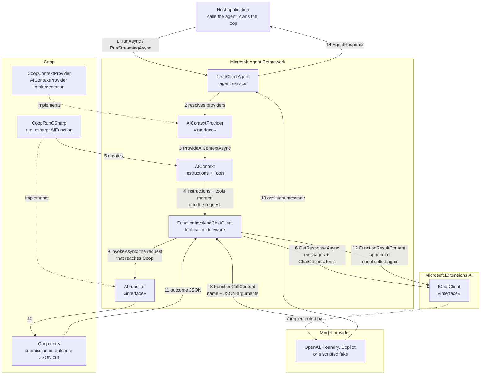

# How a request reaches Coop

One turn, from the caller to Coop. The subject is the **delivery path**: which interface the framework crosses, what it puts on each edge, and where Coop appears.

## The delivery mechanism, in words

The framework does not call Coop with a request object. It calls it through two interfaces, and the shape of the call is what matters.

| Step | Interface crossed | What actually travels |
| --- | --- | --- |
| 3–5 | `AIContextProvider.ProvideAIContextAsync` | Coop hands the framework an `AIContext` carrying an instruction string and one `AIFunction`. It contributes nothing else |
| 6 | `IChatClient.GetResponseAsync` | The framework sends the conversation plus the tool descriptions to the model. The model never sees Coop; it sees a tool named `run_csharp` with a description |
| 8 | model → `FunctionInvokingChatClient` | The model replies with `FunctionCallContent`: a tool name and JSON arguments. This is where the model's intent becomes a callable request |
| 9 | `AIFunction.InvokeAsync` | The middleware invokes the function by name. This is the single point where a model's output becomes code that runs |
| 11–12 | `FunctionResultContent` | Coop's JSON is appended to the conversation as a tool result, and **the model is called a second time**. A result that is not delivered back is a tool that ran for nothing |

Three consequences follow from that path, and each one has bitten in practice:

- **The tool description is the whole contract.** The model chooses by name and description alone. Coop never sees a request that the model did not first decide to make.
- **`FunctionInvokingChatClient` is the security boundary of the round trip.** It is the component that turns a model's `FunctionCallContent` into an invocation. Anything that must be refused — an unknown tool, a malformed argument — has to be refused there or in the function itself.
- **The second model turn is the observable proof.** An integration test that asserts only "the function ran" has not shown delivery. It must show the model was asked again and that its answer changed.

## Where the MCP route fits

`Coop.Services.Surface` is the same entry reached differently: instead of the framework invoking an `AIFunction` in-process, an MCP client sends `tools/call` over stdio. The framework can take that route too, through its own MCP client package — in which case `AIFunction` is an adapter over a remote call rather than a local method, and everything above step 9 is unchanged.
