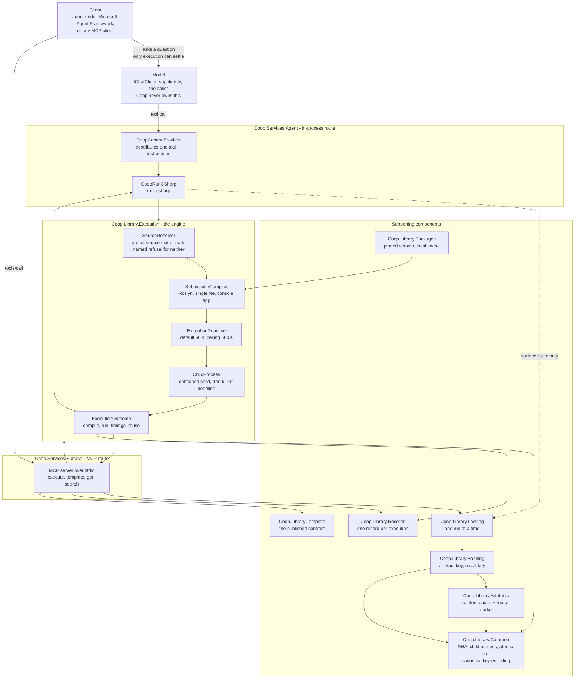
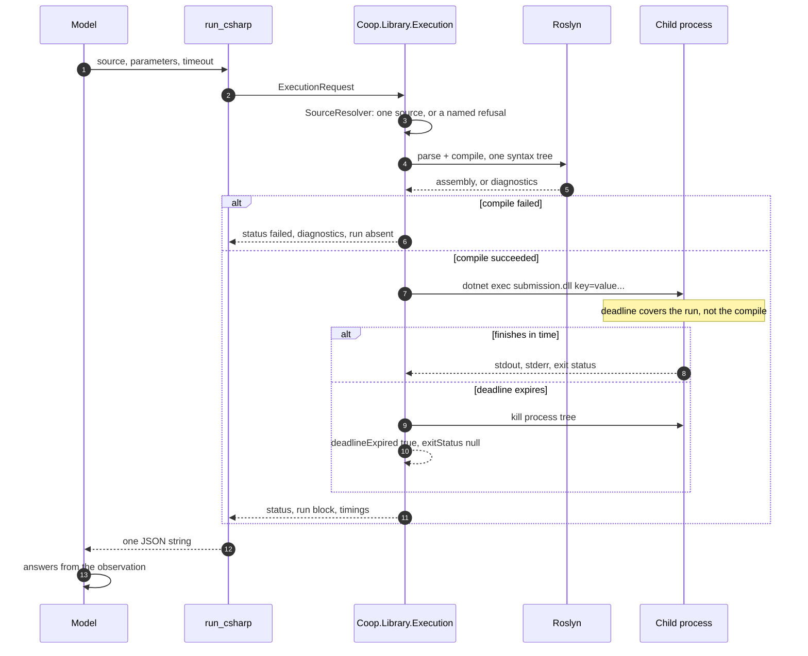
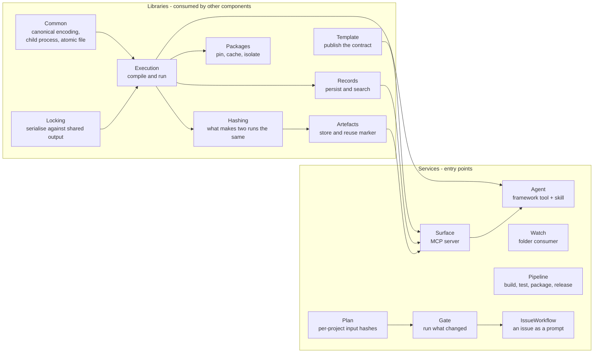
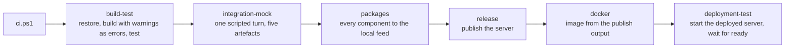
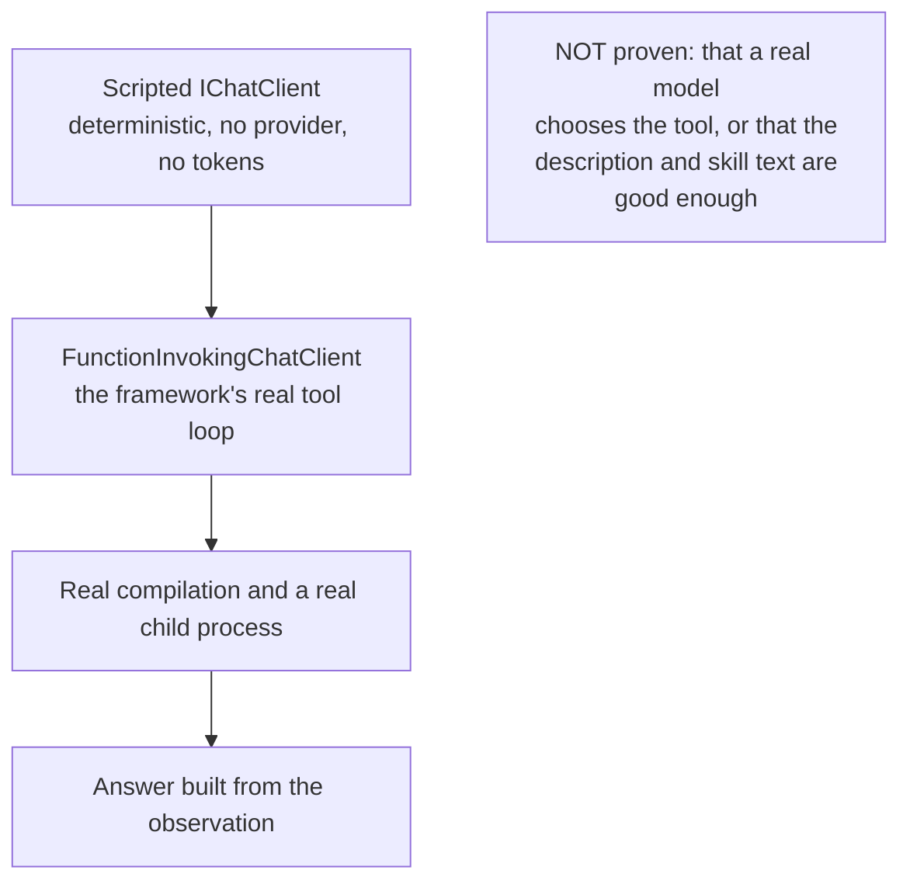

# End-to-end workflow and components

Two routes reach one engine. The diagram below is the whole system at the level a client cares about: what calls what, and which component owns which decision.

## The turn, end to end

Read it as four boundaries:

| Boundary | What crosses | What does not |
| --- | --- | --- |
| Client to Coop | A question, and a tool call carrying C# source | A credential. Coop needs none |
| Model to tool | The decision to execute rather than read | Any control of compilation, containment or deadlines |
| Tool to engine | A submission and a deadline | The caller's parameters as source text — they travel as arguments |
| Engine to host | A child process that is killed at the deadline | Any child that outlives its deadline |

## What happens inside one execution

The second half is the part worth watching: the model is asked **again** after the tool returns. A tool call whose result never comes back is a tool that ran for nothing, and that round trip is the thing an integration test has to observe.

## Components, and the one thing each owns

| Component | Owns exactly one decision |
| --- | --- |
| `Coop.Library.Execution` | Whether a submission compiles, what it printed, and whether it outlived its deadline |
| `Coop.Library.Locking` | Which invocation holds the shared build output |
| `Coop.Library.Hashing` | What makes two runs the same run |
| `Coop.Library.Packages` | Which exact versions are present, and where they came from |
| `Coop.Library.Artefacts` | Whether an answer is fresh or reused, and which run produced it |
| `Coop.Library.Records` | What happened, retrievably, after the process is gone |
| `Coop.Library.Template` | What a client is allowed to assume |
| `Coop.Services.Surface` | How a client reaches all of that without linking an assembly |
| `Coop.Services.Agent` | When an agent should reach for execution at all |

## The pipeline that proves it

`build-test` carries a duration budget and throws when it is exceeded, so a pipeline that grows announces it. `integration-mock` runs after it, so a broken build never produces a picture of a working system.

## What the mock proves, and what it does not

The offline mock is the gate: it fails the moment the wiring breaks. Whether a real model *chooses* to execute is a property of the model and its instructions, and only a live run observes it. That one question costs tokens and should be asked rarely.

## Where each artefact lives

| Artefact | Path | Produced by |
| --- | --- | --- |
| Messages between agents | `shared_tasks/queued` | either session; the durable record |
| Transcript, trace, log, timeline, page | `ci/host/integration-mock/output` | the `integration-mock` stage |
| Component packages | `nuget_repo` | the `packages` stage |
| Published server | `release/coop-surface` | the `release` stage |
| Container image | `coop-surface:0.1.0` | the `docker` stage |

All of them are generated and none is committed.
